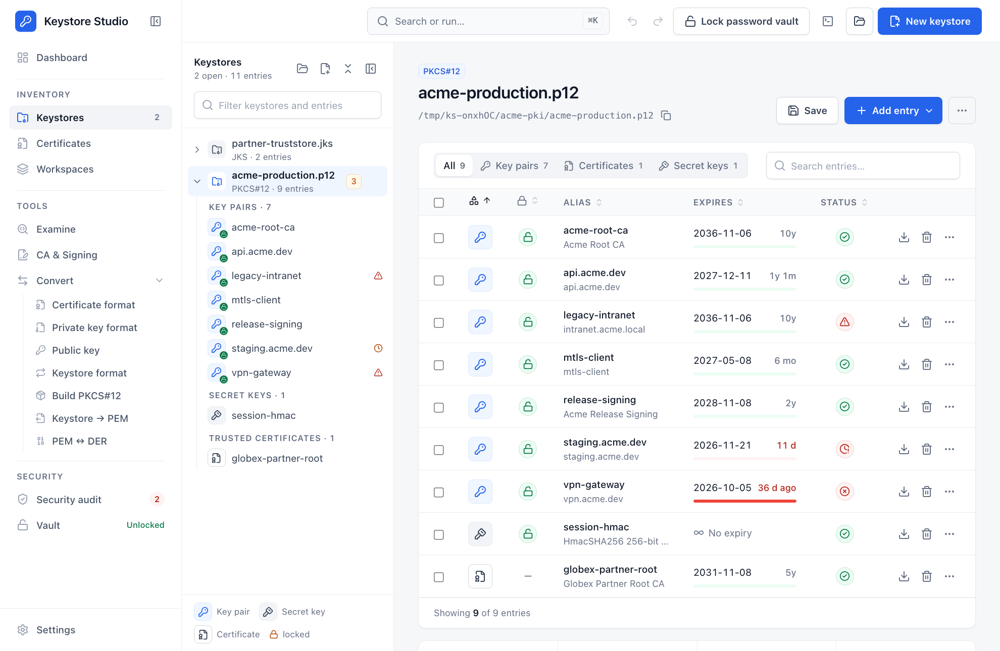
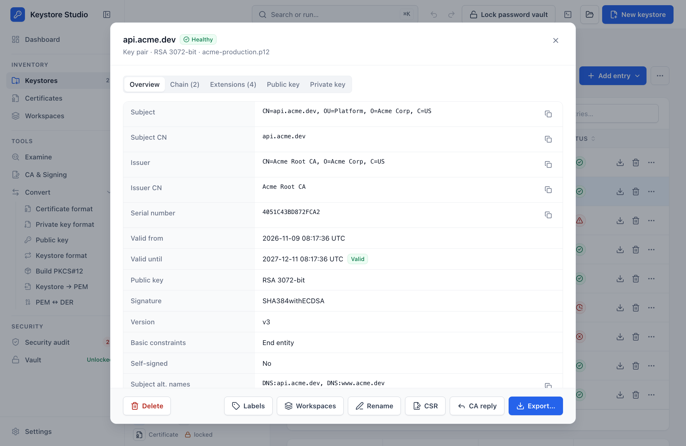
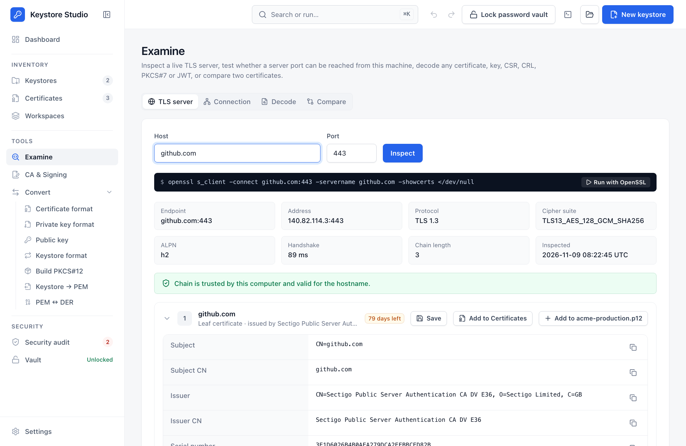
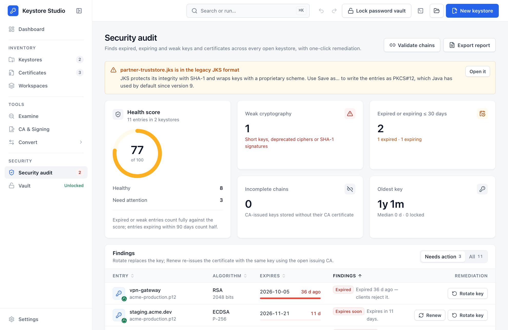
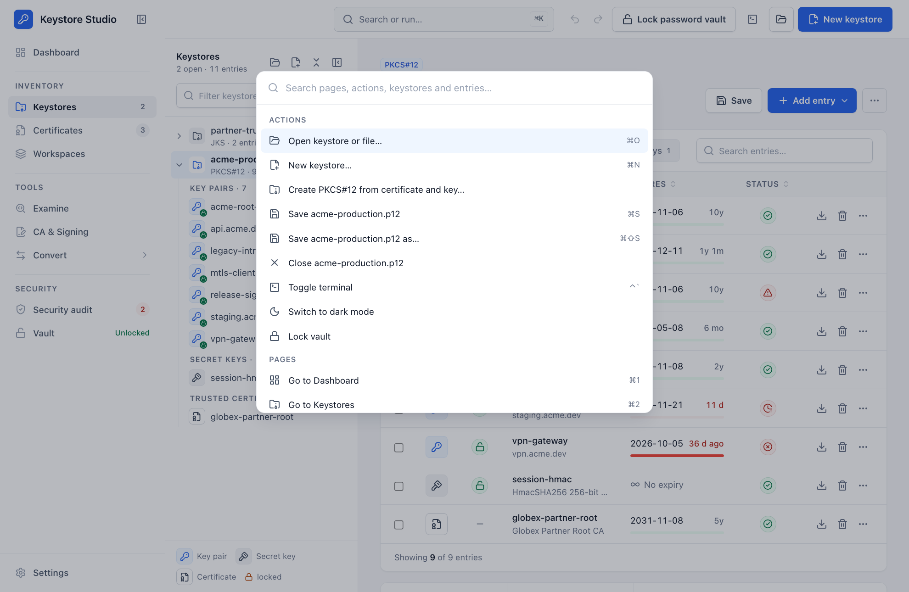

<div align="center">


# Keystore Studio

**Keystores, without the guesswork.**

A native desktop workbench for Java keystores, PKCS#12 files and X.509 certificates.<br>
Open, convert, sign, audit and inspect, with every cryptographic operation running locally in a Rust engine.

Version 1.0.0 &nbsp;|&nbsp; Windows · macOS · Linux &nbsp;|&nbsp; Free, MIT licensed

[Website](https://keystore-studio.app/) · [Get it](https://keystore-studio.app/downloads/) · [Changelog](https://keystore-studio.app/changelog/) · [Privacy](https://keystore-studio.app/privacy/) · [Feedback](https://keystore-studio.app/feedback/)

</div>


| 6 | 4 | 3 | 0 |
| :---: | :---: | :---: | :---: |
| keystore formats, all read and written | reference tools in the interop suite (`keytool`, `jarsigner`, `openssl`, `ssh-keygen`) | desktop platforms | accounts, trackers, crash reports or update checks |

---

## Contents

**Using the app**

- [Why Keystore Studio](#why-keystore-studio)
- [Download and install](#download-and-install)
- [A tour of the app](#a-tour-of-the-app)
- [Feature reference](#feature-reference)
- [Formats and algorithms](#formats-and-algorithms)
- [Keyboard shortcuts](#keyboard-shortcuts)
- [System requirements](#system-requirements)
- [Privacy and security](#privacy-and-security)
- [Limitations](#limitations)
- [FAQ](#faq)

**Working on the project**

- [Build from source](#build-from-source)
- [Development](#development)
- [Testing](#testing)
- [Architecture](#architecture)
- [Releases and website](#releases-and-website)

**More**

- [Changelog and roadmap](#changelog-and-roadmap)
- [Feedback and support](#feedback-and-support)
- [More apps from the developer](#more-apps-from-the-developer)
- [License](#license)

## Why Keystore Studio

`keytool` and `openssl` are powerful, but day-to-day certificate work still means juggling flags,
formats and passwords across two tools. Keystore Studio puts that work in one window.

| Task | With `keytool` and `openssl` | With Keystore Studio |
| --- | --- | --- |
| See what is in a keystore | `keytool -list -v -keystore acme.p12`: a wall of text, one keystore at a time | A navigator of every open keystore, entries grouped by type, expiry and health at a glance |
| Convert JKS to PKCS#12 | `keytool -importkeystore -srckeystore a.jks -srcstoretype JKS -destkeystore a.p12 -deststoretype PKCS12` | **Save as…** and pick a format. The equivalent command is shown, ready to script |
| Use BKS, UBER or BCFKS | `-providerpath bcprov.jar -providerclass …BouncyCastleProvider` on every call | Built in. No Java and no provider jar needed |
| Bundle a key and certificate | `openssl pkcs12 -export -inkey key.pem -in certificate.pem -out bundle.p12` | **Build a PKCS#12** in one step. The key is matched against the certificate before anything is written |
| Find what expires soon | A shell loop over `keytool -list -v`, then read the dates yourself | A health score across every open keystore, with **Rotate key** and **Renew** one click away |
| Check a live server | `openssl s_client -connect api.acme.dev:443 -showcerts` | Protocol, cipher, ALPN, the full chain and a trust and hostname verdict against your OS trust store |
| Undo a mistake | Edits change the file in place | Undo and redo. Saves are atomic and read back before they replace the original |
| Remember passwords | Retyped, or left in shell history | A vault under one master key (Argon2id, then AES-256-GCM) with auto-lock |

Prefer the command line? Keep it. Every converter prints the command it is equivalent to, and a
built-in terminal sits one shortcut away.

The design principles:

- **One place for every format.** Keystores, certificates, keys, CSRs, CRLs, CMS and JWTs.
- **Interoperable by design.** What the app writes is read back by `keytool`, `jarsigner` and
  `openssl` in the test suite.
- **Local only.** No accounts, no telemetry. Network requests happen only when you start them.
- **Safe with your files.** Atomic saves, undo and redo, and a guard on unsaved changes.

## Download and install

Installers are not published yet. [Build from source](#build-from-source) on any of the three
platforms:

| Platform | Packages you can build |
| --- | --- |
| **Windows** 10 and 11 | NSIS setup `.exe`, `.msi` |
| **macOS** 11 Big Sur or later | `.dmg`, `.app` |
| **Linux** (Ubuntu 22.04+, Debian 12+, Fedora 38+) | `.deb`, `.rpm`, `.AppImage` |

### Uninstall

On Windows, open **Settings → Apps**, find Keystore Studio and choose **Uninstall**. The
[data folder](#what-is-stored-and-where) is left in place so a reinstall picks up where you left
off. Delete it to remove everything.

## A tour of the app

The screenshots show the real app (production UI and Rust engine) with demo keystores made by
`keytool` and `openssl`. [Regenerate them](#regenerating-the-screenshots) after UI changes.

### Keystores

Open any number of keystores side by side. The navigator groups each keystore's entries into key
pairs, secret keys and trusted certificates. The entry table shows expiry and health at a glance,
warning badges flag expired, expiring and weak entries, and entries can be cut, copied and pasted
between stores.



### Entry inspector

Select an entry to see its subject and issuer, validity, key and signature algorithms, the full
chain, every extension and the public and private key. The same panel exports the entry, creates a
CSR, installs a CA reply, renames it or adds labels.



### Certificates

Certificate files opened on their own (PEM, DER, chains, PKCS#7 bundles) get their own page, with
one row per certificate. Filter CAs from end-entity certificates, add them to a keystore or
workspace, and export them in any format.


### Examine

Point it at a server and read the handshake: protocol, cipher suite, ALPN, handshake time, the full
chain, and a trust and hostname verdict against your operating system's trust store. The same page
tests whether a port is reachable, decodes anything you paste, and compares two certificates.



### CA & Signing

Use any CA key pair in an open keystore as a certificate authority. Sign CSRs (after the request is
verified and its SANs and usages are shown), issue CRLs, create and verify CMS/PKCS#7 signatures,
sign and verify JWTs, sign JARs that `jarsigner` accepts, add RFC 3161 timestamps and generate DH
parameters.


### Convert

Every format conversion in one place. Each converter shows the equivalent `openssl`, `ssh-keygen`
or `keytool` command, so you can script what you just did.


### Security audit

One health score across every open keystore, with findings for expired and expiring certificates,
short keys, SHA-1 signatures, legacy keystore formats and incomplete chains. **Rotate key** replaces
the key and keeps the subject, SANs and usages. **Renew** re-issues the certificate with the same key
from the open issuing CA. The report exports to CSV.



### Vault

Remember keystore passwords under a single master key. Keystores from your last session reopen as
soon as the vault is unlocked, and the vault auto-locks after inactivity.


### Terminal and command palette

A built-in terminal (`` Ctrl+` ``) runs `keytool`, `openssl` and friends without leaving the app,
with ready-made commands for the open keystores. `Test-NetConnection` works on every platform. The
command palette (`Ctrl+K`) reaches every page, action, keystore and entry.




### Dark theme

Light, dark (true black) or follow the system, under **Settings → General → Appearance**.

| Keystores | Dashboard |
| --- | --- |
|  |  |

## Feature reference

### Keystores

- Open, create, edit and save **PKCS#12**, **JKS**, **JCEKS** and Bouncy Castle **BKS**, **UBER**
  and **BCFKS** files, side by side. Output is `keytool` and OpenSSL compatible, and the Bouncy
  Castle writers reproduce Bouncy Castle's own files byte for byte.
- Convert between all six formats and change passwords with **Save as…**.
- Write PKCS#12 in a compatibility profile (3DES, SHA-1 MAC) for Java 8 and Windows 7.
- Open stores that have no password.
- **Locked key pairs:** key pairs open locked and need their key password before they can be
  inspected, exported, copied or used for signing. Settings can turn this off. Per-key passwords in
  JKS and JCEKS are preserved.
- Undo and redo (also across opened files), cut, copy and paste between keystores, rename, labels,
  and a CSV inventory export.
- Unsaved changes are tracked and guarded when you close a keystore or quit.

### Entries

- **Generate** RSA (2048–4096), ECDSA (P-256, P-384, P-521) and Ed25519 key pairs, with certificates
  that are self-signed or issued by any open CA.
- **Generate** AES, HMAC and 3DES secret keys.
- **Import** trusted certificates and bundles, and key pairs from PEM or DER, OpenSSH, JWK or another
  keystore.
- **Request** certificates: create CSRs and install the CA reply into its key pair.
- **Export** certificates, chains, public keys, private keys, single-entry PKCS#12 files and secret
  keys (see [Formats](#formats-and-algorithms)).

### Build a PKCS#12

Bundle an existing certificate or chain and its private key into a passphrase-protected `.p12` or
`.pfx` in one step, without opening a keystore first. Start it from the dashboard or the command
palette. The input key may be encrypted (its password is asked for separately), and it is matched
against the certificate before anything is written. The result is readable by OpenSSL and `keytool`.

### Certificates page

- Lists certificate files opened on their own, one row per certificate with type, algorithm, expiry
  and health.
- Inspect, export (PEM, DER, PKCS#7, public key, JWK), copy, or add to an open keystore or a
  workspace.
- Paste PEM, or keep certificates found in Examine.
- The list survives restarts, and removing a certificate never changes its file.

### Convert

| From → to | Formats |
| --- | --- |
| Certificates | PEM, DER, PKCS#7, PkiPath, Netscape sequence |
| Certificates → truststore | Any of the six keystore formats |
| Private keys | PKCS#8, encrypted PKCS#8 (AES or legacy 3DES), PKCS#1/SEC1, OpenSSH, JWK |
| Public keys (from a certificate, CSR or key) | PEM, DER, PKCS#1, OpenSSH, SSH2, JWK |
| Keystores | Between all six formats, or to a PEM bundle |
| Key + certificate | PKCS#12 |
| Any object | PEM ↔ DER |

Each converter shows the equivalent command, with the Bouncy Castle provider flags where `keytool`
needs them.

### CA & Signing

- Sign CSRs with CSR inspection and one-click installation into the matching key pair.
- Issue v2 CRLs. The app records the certificates you issue so that later CRLs can revoke them.
- Sign and verify CMS/PKCS#7 (attached or detached).
- Sign and verify JWTs (RS, ES, EdDSA, HS).
- Sign JARs that `jarsigner` verifies.
- Add **RFC 3161 trusted timestamps** to CMS and JAR signatures.
- Generate DH parameters from the RFC 7919 groups or as freshly generated safe primes.

### Examine

- **Live TLS inspection:** protocol, cipher, ALPN, handshake time, full chain, and a trust and
  hostname verdict against the OS trust store.
- **Connection test:** whether a server port can be reached from this machine, showing every
  resolved address, source address and interface, connect time, and why it failed (refused, timed
  out, unreachable or not resolved).
- **Revocation checks:** check a certificate chain with its CA over OCSP or CRL, only when you ask.
- **Decode:** paste or pick certificates, chains, CSRs, CRLs, keys, PKCS#7, JWTs, OpenSSH keys or
  keystores.
- **Compare** two certificates side by side.

Opened key, CSR, CRL and signature files land here. Certificate files go to Certificates.

### Security audit

- A health score across every open keystore.
- Findings for expired and expiring certificates, weak keys and digests, deprecated ciphers,
  incomplete chains and self-signed servers.
- **Rotate key** keeps subject, SANs and usages, and is re-issued by the original CA when it is open.
- **Renew** re-issues the certificate with the same key.
- CSV report.

### Workspaces

Group keystore entries and certificates by project or audit scope. Workspaces persist across
sessions.

### Vault

- One master key, derived with **Argon2id**. Each secret is sealed on its own with **AES-256-GCM**.
- Auto-lock after inactivity.
- Changing the master key re-encrypts every secret. A forgotten key can only be reset.
- Keystores from the last session reopen once the vault is unlocked.

### Productivity and tools

- Command palette, keyboard shortcuts, window-wide drag and drop, recent files and session restore.
- Built-in terminal with ready-made `keytool` and `openssl` commands.
- `Test-NetConnection` built into the terminal on every platform (`-ComputerName`, `-Port`,
  `-CommonTCPPort`, `-InformationLevel Detailed|Quiet`).
- **Settings → Tools** lists the command-line tools the app refers to (`java`, `keytool`,
  `jarsigner`, the Bouncy Castle provider jar, OpenSSL, `ssh-keygen`, PuTTYgen): found or not,
  version, path, what uses each, and the install command for missing ones. The engine needs none of
  them.
- Light, dark (true black) or system theme.

## Formats and algorithms

### Keystore formats

| Format | Extensions | Support | Notes |
| --- | --- | --- | --- |
| **PKCS#12** | `.p12` `.pfx` | Read and write | Java's default since version 9. Classic MAC for maximum compatibility; PBMAC1 (RFC 9579) is read and can be written. Optional 3DES / SHA-1 MAC profile |
| **JKS** | `.jks` | Read and write | Legacy Java format. Per-key passwords preserved; the audit suggests moving to PKCS#12 |
| **JCEKS** | `.jceks` | Read and write | Java's store for secret keys, including sealed secret key entries. Per-key passwords preserved |
| **BKS** | `.bks` | Read v1 and v2, write v2 | Bouncy Castle keystore |
| **UBER** | `.uber` | Read and write | Bouncy Castle's encrypted-container keystore. Store version 0 is not read |
| **BCFKS** | `.bcfks` | Read and write | Bouncy Castle FIPS keystore. See [Limitations](#limitations) |

### Import and export

| Object | Opens and imports | Exports and converts to |
| --- | --- | --- |
| Keystores | PKCS#12, JKS, JCEKS, BKS, UBER, BCFKS, including stores without a password | All six formats, single-entry PKCS#12, PEM bundle, a truststore from certificates |
| Certificates | PEM, DER, chains, PKCS#7 bundles, PkiPath, Netscape sequence | PEM, DER, full chain, PKCS#7 (PEM or DER), PkiPath, Netscape sequence |
| Private keys | PKCS#8 (including scrypt and PBES1), PKCS#1, SEC1, DSA, OpenSSL `Proc-Type` encrypted PEM, OpenSSH, JWK | Encrypted or plain PKCS#8, PKCS#1/SEC1, OpenSSH, JWK |
| Public keys | From a certificate, CSR or key; SSH2 public keys | PEM, DER, PKCS#1, OpenSSH, SSH2 (RFC 4716), JWK |
| Secret keys | Generate AES, HMAC and 3DES | Hex, JWK |
| CSRs, CRLs, CMS, JWTs | Decode and inspect in Examine | Sign CSRs, issue v2 CRLs, sign and verify CMS and JWTs |

### Algorithms

| Purpose | Supported |
| --- | --- |
| Key pairs | RSA 2048–4096, ECDSA P-256 / P-384 / P-521, Ed25519 |
| Secret keys | AES, HMAC, 3DES |
| Signing | X.509 v3 certificates, CSRs, v2 CRLs, CMS/PKCS#7, JWT (RS, ES, EdDSA, HS), JAR, RFC 3161 timestamps |
| Key exchange parameters | DH (RFC 7919 groups or generated safe primes) |

## Keyboard shortcuts

Shortcuts use `Ctrl` on Windows and Linux and `⌘` on macOS (`Ctrl` works there too).

| Action | Shortcut | Action | Shortcut |
| --- | --- | --- | --- |
| Open | `Ctrl+O` | Command palette | `Ctrl+K` |
| New keystore | `Ctrl+N` | Terminal | `` Ctrl+` `` |
| Save | `Ctrl+S` | Switch page | `Ctrl+1` … `Ctrl+8` |
| Save as | `Ctrl+Shift+S` | Convert | `Ctrl+9` |
| Undo / redo | `Ctrl+Z` / `Ctrl+Shift+Z` | Certificates | `Ctrl+0` |

## System requirements

| | Windows | macOS | Linux |
| --- | --- | --- | --- |
| Versions | 10 and 11 | 11 Big Sur or later | Ubuntu 22.04+, Debian 12+, Fedora 38+ or similar |
| Architecture | x64 (ARM64 from source) | Apple silicon, Intel or universal | x86_64 (ARM64 from source) |
| Web engine | WebView2, installed by setup if missing | WKWebView with Safari 16.4 or later | WebKitGTK 4.1, version 2.40 or later |
| Packages (from source) | NSIS setup `.exe`, `.msi` | `.dmg`, `.app` | `.deb`, `.rpm`, `.AppImage` |
| Built-in terminal | `cmd.exe` | `/bin/sh` | `/bin/sh` |

- **Window:** at least 1024 × 680; opens at 1320 × 860.
- **Java and OpenSSL are not needed.** The Rust engine does all the cryptography. `keytool`,
  `openssl` and friends are optional, for the built-in terminal and the suggested commands.
- The interface needs a Safari 16.4-class web engine (it uses `color-mix()`, `@property` and cascade
  layers), which sets the macOS and WebKitGTK minimums.
- The AppImage needs FUSE 2 (`sudo apt install libfuse2` on Ubuntu 22.04+).

## Privacy and security

Keystore Studio has no accounts, no analytics, no advertising, no crash reporting and no automatic
update checks. It collects no personal data. The full statement is on the
[privacy page](https://keystore-studio.app/privacy/) and in the app under **Settings → About**.

### What stays in memory

Keystore contents and passwords are held in memory only. They reach disk solely in the keystore
files you save. Passwords you do not store in the vault are forgotten when the app quits. Saves are
written atomically, then read back to verify them before they replace the original.

### What is stored, and where

The app data folder holds the following. No key material is stored there.

- Settings, workspaces, labels, and the paths of recent and open files.
- The certificates listed on the Certificates page (public certificates only).
- The vault, if you set one up: remembered keystore passwords, encrypted.
- A record of the certificates you issue as a CA (serial number, subject, key identifiers and expiry
  date) and the last CRL number of each CA.

| OS | Data folder |
| --- | --- |
| Windows | `%APPDATA%\keystore-studio` |
| macOS | `~/Library/Application Support/keystore-studio` |
| Linux | `~/.local/share/keystore-studio` |

Set `KEYSTORE_STUDIO_DATA_DIR` to use another folder. A data folder left by the app under its former
name, `xkeystore`, is moved to the new location on first start, so your vault, session and settings
carry over.

### The vault

| Step | What happens |
| --- | --- |
| Master key | You type it. It is never stored |
| Derivation | Argon2id produces the vault key at each unlock |
| Sealing | Each password is sealed on its own with AES-256-GCM, with its ID bound as associated data, so one sealed secret cannot be swapped for another |
| On disk | Only ciphertext, in the app data folder |

### Network requests

The app makes network requests in exactly four situations, and only when you start them.

| Where | Action | What is contacted and sent |
| --- | --- | --- |
| Examine | Inspect a TLS server | The host and port you enter, with a TLS handshake like a browser or `openssl s_client` |
| Examine | Test a connection | A TCP connection to the host and port you enter |
| Settings → Signing | Request an RFC 3161 timestamp (when timestamps are on) | A hash of what you signed goes to the timestamp authority you chose, with the app name and version as the user agent. Content and keys are not sent |
| Certificate chain | Check revocation online (when you ask) | The certificate's OCSP responder or CRL server. This tells the CA which certificate is being checked. Keys are not sent |

Commands you run in the built-in terminal run with your permissions; what they send is up to the
command. Separately, a Windows setup you build downloads WebView2 from Microsoft if it is missing.

### Clipboard

The app writes to the clipboard only when you copy something. **Copy diagnostics** includes the app
version, platform, data folder, and the names and aliases of open keystores, never passwords or key
material.

### Your control

- **Settings → Data → Reset app data** clears settings, workspaces, labels, recent files and the
  Certificates list.
- Records of issued certificates are deleted one by one in CA & Signing.
- Resetting the vault on the Vault page deletes the remembered passwords.
- Deleting the data folder removes everything the app keeps. Uninstalling leaves it in place.

### Hardening

- **Strict Content Security Policy.** The webview loads only the app's own scripts and styles and
  talks only to the Rust engine over Tauri's IPC channel:

  ```text
  default-src 'self'; script-src 'self'; style-src 'self' 'unsafe-inline'; img-src 'self' data:;
  font-src 'self' data:; connect-src ipc: http://ipc.localhost; object-src 'none';
  base-uri 'self'; form-action 'none'; frame-ancestors 'none'
  ```

- **Fuzzed parsers.** Every parser is fed truncations, bit flips, forged length headers of real
  keystores and deep nesting, and must return an error rather than panic. Coverage-guided fuzz
  targets get a smoke run in CI.
- **Dependency checks.** `cargo deny` checks Rust dependencies for advisories, licences, sources and
  bans in CI, alongside clippy and rustfmt.

To report a security vulnerability, see [Feedback and support](#feedback-and-support).

## Limitations

- **Bouncy Castle edge cases.** BCFKS stores protected with HMAC-SHA3-512 are refused, and PBE-key
  entries are listed as not shown. A signature-protected BCFKS store is verified against the
  certificate inside it, without a trust decision, and is saved back with a password MAC. UBER store
  version 0 is not read.
- **PuTTY `.ppk`** keys are not read. Convert them with
  `puttygen key.ppk -O private-openssh`, then open the OpenSSH key.
- **PKCS#11 hardware tokens** are not supported. Keys on a token cannot be exported, so signing has to
  happen on the device through a vendor library, which does not fit the "a keystore is a file" model.
- **Post-quantum keys** (ML-DSA, ML-KEM, SLH-DSA) written by newer JDKs, and DSA, Ed448 and RSA-PSS
  keys, load and save losslessly but cannot be used for signing. DSA and RSA-PSS signatures on
  certificates, CSRs and CRLs are verified.
- **Timestamp authorities.** Timestamp tokens are bound to the signature they cover, but the
  authority's own certificate chain is not validated in the app. `openssl ts -verify` and
  `jarsigner -verify` do that.

## FAQ

<details>
<summary><strong>Is Keystore Studio free?</strong></summary>

Yes. It is open source under the MIT licence, for personal and commercial use. There are no accounts,
no paid tier and nothing to sign up for.
</details>

<details>
<summary><strong>When are installers coming?</strong></summary>

No date yet. Until they are published, [build your own from source](#build-from-source).
</details>

<details>
<summary><strong>Do I need Java, keytool or OpenSSL installed?</strong></summary>

No. You only need them to run those commands yourself in the terminal. **Settings → Tools** shows
which are installed and how to install the missing ones.
</details>

<details>
<summary><strong>Does it send my keys or passwords anywhere?</strong></summary>

No. See [Network requests](#network-requests) for the complete list.
</details>

<details>
<summary><strong>Will the files it writes work with older Java?</strong></summary>

PKCS#12 files are written with the classic MAC for maximum compatibility, and the optional 3DES /
SHA-1 MAC profile targets Java 8 and Windows 7. PBMAC1 (RFC 9579) is written only when you ask.
</details>

<details>
<summary><strong>What if I forget my vault master key?</strong></summary>

It is never stored, so it cannot be recovered. Reset the vault on the Vault page: the remembered
passwords are deleted, and your keystore files are not touched.
</details>

## Build from source

Tauri builds each installer on its own operating system, so build on the platform you want to run.

### 1. Prerequisites

- **Node 22**
- **pnpm 9** ([`package.json`](package.json) pins the exact version)
- **Rust stable** (edition 2024), via [rustup](https://rustup.rs)
- The [Tauri v2 system dependencies](https://v2.tauri.app/start/prerequisites/) below

<details>
<summary><strong>Windows</strong></summary>

Install [Visual Studio Build Tools](https://visualstudio.microsoft.com/visual-cpp-build-tools/) with
the **Desktop development with C++** workload, then use the MSVC toolchain:

```powershell
rustup default stable-msvc
```

WebView2 is already on current Windows 10 and 11. MSI builds use WiX v3, which needs the VBSCRIPT
optional feature on Windows 11 24H2 and later (**Settings → System → Optional features**).
</details>

<details>
<summary><strong>macOS</strong></summary>

```bash
xcode-select --install
```
</details>

<details>
<summary><strong>Debian and Ubuntu</strong></summary>

```bash
sudo apt-get update
sudo apt-get install -y \
  build-essential curl wget file \
  libwebkit2gtk-4.1-dev libgtk-3-dev libsoup-3.0-dev libjavascriptcoregtk-4.1-dev \
  librsvg2-dev libayatana-appindicator3-dev libssl-dev libxdo-dev
```
</details>

<details>
<summary><strong>Fedora</strong></summary>

```bash
sudo dnf install -y \
  gcc gcc-c++ make curl wget file \
  webkit2gtk4.1-devel gtk3-devel libsoup3-devel javascriptcoregtk4.1-devel \
  librsvg2-devel libappindicator-gtk3-devel openssl-devel libxdo-devel
```
</details>

### 2. Clone and build

```bash
git clone https://github.com/framedparadox/keystore-studio.git
cd keystore-studio
pnpm install --frozen-lockfile
pnpm tauri build        # writes installers to src-tauri/target/release/bundle/
```

`pnpm tauri build` runs the TypeScript check and the Vite bundle first, then compiles the Rust app in
release mode, and produces every format your system supports.

### 3. Pick up your installer

| Platform | Only one format | Output, under `src-tauri/target/release/bundle/` |
| --- | --- | --- |
| macOS | `--bundles dmg` | `dmg/Keystore Studio_1.0.0_aarch64.dmg` or `_x64.dmg`, `macos/Keystore Studio.app` |
| Windows | `--bundles nsis` or `msi` | `nsis/Keystore Studio_1.0.0_x64-setup.exe`, `msi/Keystore Studio_1.0.0_x64_en-US.msi` |
| Linux | `--bundles deb`, `rpm` or `appimage` | `deb/*.deb`, `rpm/*.rpm`, `appimage/*.AppImage` |

Prefer an `.msi` for Intune or Group Policy? Build it on your own Windows machine.

### Platform variants

**Universal macOS build** (Apple silicon and Intel in one `.dmg`, written under
`src-tauri/target/universal-apple-darwin/release/bundle/`):

```bash
rustup target add aarch64-apple-darwin x86_64-apple-darwin
pnpm tauri build --target universal-apple-darwin --bundles dmg
```

**Windows on ARM64** (needs the MSVC ARM64 build tools; WiX cannot build ARM64 MSIs, so use NSIS):

```powershell
rustup target add aarch64-pc-windows-msvc
pnpm tauri build --target aarch64-pc-windows-msvc --bundles nsis
```

**Linux:** build on the oldest distribution you want to support, because the binary links against that
system's glibc and WebKitGTK. For ARM64, build on an ARM64 machine with the same commands.

### Unsigned macOS builds

A signed and notarized `.dmg` is not published yet. A build you make yourself runs on the Mac that
built it; elsewhere Gatekeeper blocks it or reports it as damaged. To test on another Mac,
right-click the app and choose **Open**, or clear the quarantine flag:

```bash
xattr -dr com.apple.quarantine "/Applications/Keystore Studio.app"
```

## Development

**Stack:** a Rust engine (edition 2024), a Tauri v2 app shell with every command run off the UI
thread, and a React and TypeScript interface styled with Tailwind CSS in the system webview.

```bash
pnpm install
pnpm tauri dev          # desktop app with hot reload
pnpm tauri build        # release bundles
```

`pnpm dev` serves the UI in a browser for layout work only; the native engine is unavailable there.

### Regenerating the screenshots

```bash
pnpm screenshots        # pnpm build && node e2e/readme-screenshots.mjs
```

This creates demo keystores and certificates with `keytool` and `openssl`, then drives the real UI in
headless Chrome against the real engine (the same set-up as the headless UI tests below). It writes
the PNGs to `docs/screenshots/`. The Examine screenshot inspects `github.com:443`, so it needs network
access. `XKS_SCREENSHOTS=<dir>` writes them somewhere else.

## Testing

```bash
pnpm typecheck          # TypeScript
pnpm test               # frontend unit tests (Vitest)
pnpm test:rust          # Rust unit tests + interop tests against keytool, jarsigner and openssl
pnpm test:e2e           # builds the app and drives a full user journey via tauri-driver
pnpm test:e2e:mac       # the end-to-end journey on macOS
pnpm test:e2e:headless  # drives the real UI in headless Chrome against the real engine
pnpm test:all           # typecheck, unit tests, clippy and Rust tests in one go
pnpm fuzz               # coverage-guided fuzz targets (needs nightly Rust and cargo-fuzz)

# What the CI lint job runs:
cargo fmt --manifest-path src-tauri/Cargo.toml -- --check
cargo clippy --manifest-path src-tauri/Cargo.toml --all-targets -- -D warnings
cargo deny --manifest-path src-tauri/Cargo.toml check    # advisories, licences, sources, bans
```

| Suite | Where | What it covers |
| --- | --- | --- |
| **Interop** | `src-tauri/tests/interop.rs` | Round-trips keystores, CSRs, CRLs, CMS, JARs, DH parameters and exports through the real `keytool`, `jarsigner`, `openssl` and `ssh-keygen`, and runs a TLS handshake against `openssl s_server`. A test is skipped if its tool is missing |
| **Robustness** | `src-tauri/tests/robustness.rs` | Feeds every parser malformed input and asserts an error, not a panic. `XKS_MUTATION_POINTS=2000` runs a deeper sweep |
| **Fuzzing** | `src-tauri/fuzz/` | Coverage-guided targets; see [src-tauri/fuzz/README.md](src-tauri/fuzz/README.md) |
| **End-to-end (Linux)** | `e2e/app.e2e.mjs` | Creates, saves, edits, signs, audits, restarts and restores a session, then verifies the files with `keytool` and `openssl` |
| **End-to-end (macOS)** | `e2e/eval-drive.mjs` | The real window, driven over a local bridge |
| **End-to-end (browser)** | `e2e/headless-ui.mjs` | The real UI in headless Chrome against the real engine |

### End-to-end notes

- **Linux** needs `tauri-driver` (`cargo install tauri-driver --locked`) and WebKitWebDriver
  (`webkit2gtk-driver` on Debian/Ubuntu). On a headless machine, run it with `xvfb-run -a`. Native
  file dialogs are scripted only when the app is started with `KEYSTORE_STUDIO_E2E=1`.
- **macOS** replaces the Linux journey, because `tauri-driver` has no WKWebView backend. It needs no
  display permissions. The binary **must** be built with the `custom-protocol` feature (`pnpm
  test:e2e:mac` does this); without it the webview points at `devUrl` and stays blank unless `pnpm
  dev` is running.
- **Browser** needs no Tauri build, which suits UI iteration and CI without a WebKit runtime. It
  serves the production `dist/` bundle and points `window.__TAURI_INTERNALS__` at
  `src-tauri/examples/ui_bridge.rs`, which calls the same engine functions as the Tauri commands.
  Only the webview and IPC transport are replaced. Selenium Manager downloads Chrome for Testing
  (stable by default). `XKS_CHROME=system` uses the installed Chrome, any other value selects a
  version or channel, and `XKS_SCREENSHOTS=<dir>` saves screenshots.

### Continuous integration

[`ci.yml`](.github/workflows/ci.yml) runs on pushes to `main` and on pull requests:

- type check, frontend unit tests and build;
- Rust tests with the interop suite on Linux, macOS and Windows;
- rustfmt, clippy and `cargo deny` (advisories are informational);
- a fuzz smoke run;
- the Linux WebDriver journey and the headless UI suite;
- installer builds: `.deb` (Linux), `.dmg` (macOS) and `.msi` (Windows).

## Architecture

```text
┌──────────────────────────────┐   Tauri IPC   ┌──────────────────────────────┐
│ React + TypeScript UI        │ ────────────▶ │ Rust engine                  │
│ system webview, strict CSP   │ ◀──────────── │ keystores, X.509, signing,   │
│ src/                         │               │ TLS, vault  (src-tauri/src/) │
└──────────────────────────────┘               └──────────────────────────────┘
```

```text
src/                        React UI
  state/store.tsx           app state: open keystores (+ in-memory passwords), undo/redo, workspaces,
                            labels, settings, vault status, open/save/close flows, session persistence
  lib/api.ts                typed wrappers for every Tauri command
  views/                    one file per page
  components/               shared UI, dialogs, terminal, command palette
src-tauri/src/              Rust engine (crate keystore_studio_lib)
  keys.rs  x509.rs          keys, signing/verification, certificate/CSR/CRL building and parsing
  keystore.rs               the keystore model shared by the codecs
  pkcs12.rs  jks.rs         keystore codecs (javaser.rs: JCEKS sealed secret keys; pbe.rs: PBE schemes)
  bks.rs  bcfks.rs          Bouncy Castle BKS/UBER and BCFKS (modes.rs: AES-CCM, AES-KWP, RC4)
  openssh.rs                OpenSSH private keys and RFC 4716 public keys
  ops.rs  entry.rs          entry operations and display models
  convert.rs  export.rs     format conversion and export
  detect.rs                 file type detection
  cms.rs  jwt.rs  jar.rs    CMS/PKCS#7, JWT and JAR signing
  tsa.rs                    RFC 3161 timestamps
  dh.rs  ffdhe.rs           DH parameters and RFC 7919 groups
  tls.rs  netcheck.rs       TLS inspection and TCP connection test
  ocsp.rs  revocation.rs    OCSP and CRL revocation checks
  vault.rs                  master-key vault
  terminal.rs  tools.rs     built-in shell and external tool detection
  commands.rs               Tauri commands, behind the tauri-app feature
src-tauri/examples/
  ui_bridge.rs              HTTP sidecar exposing the engine to the headless UI tests and screenshots
src-tauri/tests/            interop, robustness and feature tests
src-tauri/fuzz/             fuzz targets
e2e/                        end-to-end suites and the README screenshot script
website/                    keystore-studio.app (static site)
```

The engine modules depend on no GUI toolkit: building with `--no-default-features` gives the engine
alone, which is how the fuzz targets and the UI bridge link it.

## Releases and website

### Release builds

Pushing a `v*` tag, or running [`release-download.yml`](.github/workflows/release-download.yml) by
hand, builds installers and attaches them to the GitHub release: a Windows NSIS `.exe` and x64
`.msix`, a macOS `.dmg`, and Linux `.AppImage`, `.deb` and `.rpm` packages. The NSIS, macOS and Linux
installers remain unsigned. The MSIX is unsigned unless the repository secrets
`MSIX_CERTIFICATE_BASE64` (base64-encoded PFX) and `MSIX_CERTIFICATE_PASSWORD` are configured; the
signing certificate must be trusted by target machines.

The version lives in [`package.json`](package.json),
[`src-tauri/tauri.conf.json`](src-tauri/tauri.conf.json) (the one installers use) and
[`src-tauri/Cargo.toml`](src-tauri/Cargo.toml). Keep all three the same.

### Website

[keystore-studio.app](https://keystore-studio.app/) lives in [`website/`](website/): plain HTML, CSS
and JavaScript with no build step, no CDNs, no web fonts, no cookies and no analytics.

```bash
cd website
python3 -m http.server 8000     # http://localhost:8000/
```

It is deployed as a Cloudflare Worker with static assets, and installers are to be served from
Cloudflare R2. Two workflows handle this on pushes to the `website` branch. See
[website/README.md](website/README.md) for the file map, hosting setup and the steps for publishing a
new installer.

## Changelog and roadmap

### 1.0.0 (25 November 2026)

First public release, built from source on Windows, macOS and Linux. It includes
everything in the [feature reference](#feature-reference). Full notes are on the
[changelog page](https://keystore-studio.app/changelog/)
([Atom feed](https://keystore-studio.app/changelog/feed.xml)) and in
[GitHub releases](https://github.com/framedparadox/keystore-studio/releases).

### Road to 1.0

| Date (2026) | Milestone |
| --- | --- |
| 24 Oct | First commit |
| 9 Nov | `xkeystore` becomes Keystore Studio; Vault and Workspaces views |
| 10 Nov | OCSP revocation checking and system trust anchors |
| 13 Nov | Undo and redo in the header |
| 14 Nov | Monochrome branding and command-line tool detection |
| 15 Nov | MD5 fingerprints removed from certificate details |
| 17 Nov | Broader keystore format support and better help |
| 23 Nov | Title bar and sidebar refinements; closer JAR signing interop checks |
| 25 Nov | 1.0.0 released |

### Coming next

No dates yet.

- [ ] A signed Windows installer
- [ ] A signed and notarized macOS `.dmg`
- [ ] Published Linux `.deb`, `.rpm` and `.AppImage` packages

## Feedback and support

- **Bugs and feature requests:** [open a GitHub issue](https://github.com/framedparadox/keystore-studio/issues)
  or use the [feedback form](https://keystore-studio.app/feedback/).
- **Email:** `hello@keystore-studio.app`
- **Security vulnerabilities:** email the same address with **Security** in the subject, and keep the
  details out of public issues.

> [!WARNING]
> Never send private keys, passwords or real keystores.

A useful bug report includes:

1. The output of **Settings → Data → Copy diagnostics**.
2. What you did, what you expected and what happened, with the exact error text.
3. The keystore or file type (PKCS#12, JKS, BCFKS, PEM…) and the tool that made it, if known.
4. A throwaway test file made with `keytool` or `openssl`, and how you made it.
5. Confirmation that [Limitations](#limitations) and existing issues do not already cover it.

## More apps from the developer

The same idea applied elsewhere: local-first, no accounts, no telemetry, free and open source.
Details are on the [More apps page](https://keystore-studio.app/apps/).

| Project | Type | What it does |
| --- | --- | --- |
| [Certificate Utility](https://github.com/framedparadox/cert-util-vscode) | VS Code extension | Inspect, validate and convert certificates and scan for expiring ones in the editor; a companion to Keystore Studio |
| [Anchor](https://github.com/framedparadox/anchor-dock) | Windows app | A floating dock for pinned apps, files, folders and links |
| [SwiftX](https://github.com/framedparadox/SwiftX) | Windows app | A quick-access orbit opened by shortcut, screen corner or tray |
| [DockDev](https://github.com/framedparadox/dockdev) | Windows app | A floating developer toolbox: JSON, JWTs, file hashes, data masking |
| [VsGit](https://github.com/framedparadox/vsgit-vscode) | VS Code extension | A Git client with a commit graph that drives the real `git` binary |
| [MuleSoft AES](https://github.com/framedparadox/mulesoft-aes-vscode) | VS Code extension | Encrypt and decrypt MuleSoft secure configuration properties |
| [Developer Utility](https://github.com/framedparadox/developer-util-vscode) | VS Code extension | Format data, manage certificates, encode and decode |
| [mcp-secure-remote](https://github.com/framedparadox/mcp-secure-remote) | MCP proxy | Remote MCP proxy with mutual-TLS client certificates |
| [pr-comments](https://github.com/framedparadox/pr-comments) | CLI | Export pull request comments to CSV and a local review dashboard |

## License

[MIT](LICENSE). Free for personal and commercial use.

Java is a trademark of Oracle. OpenSSL is a trademark of the OpenSSL Software Foundation. Keystore
Studio is not affiliated with either.
