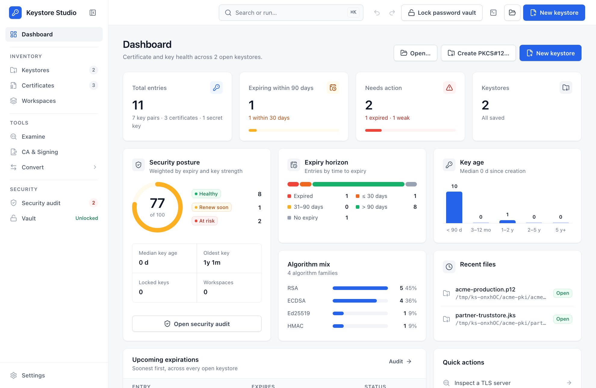
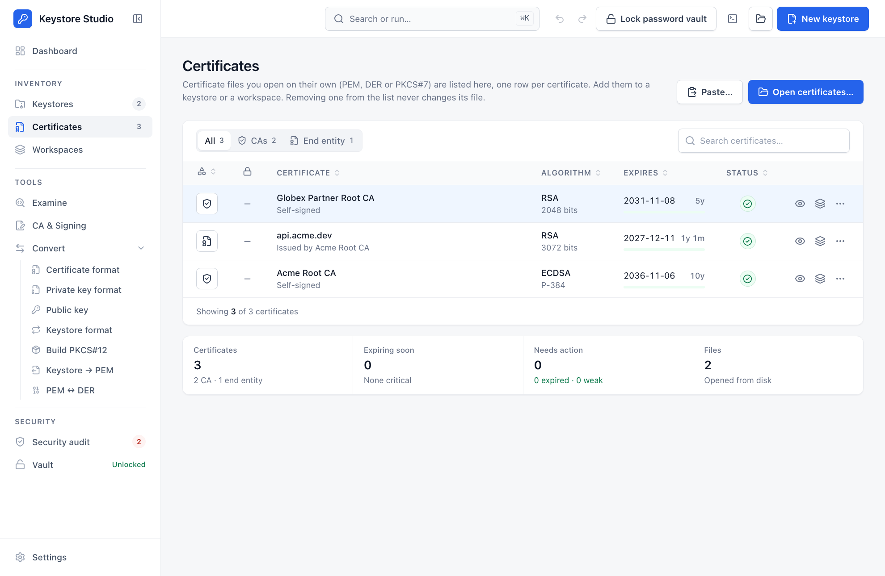
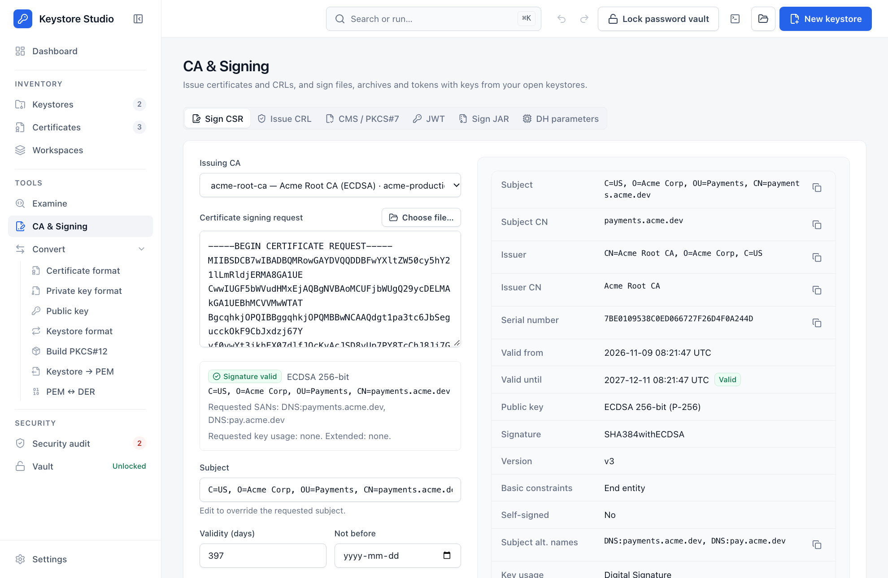
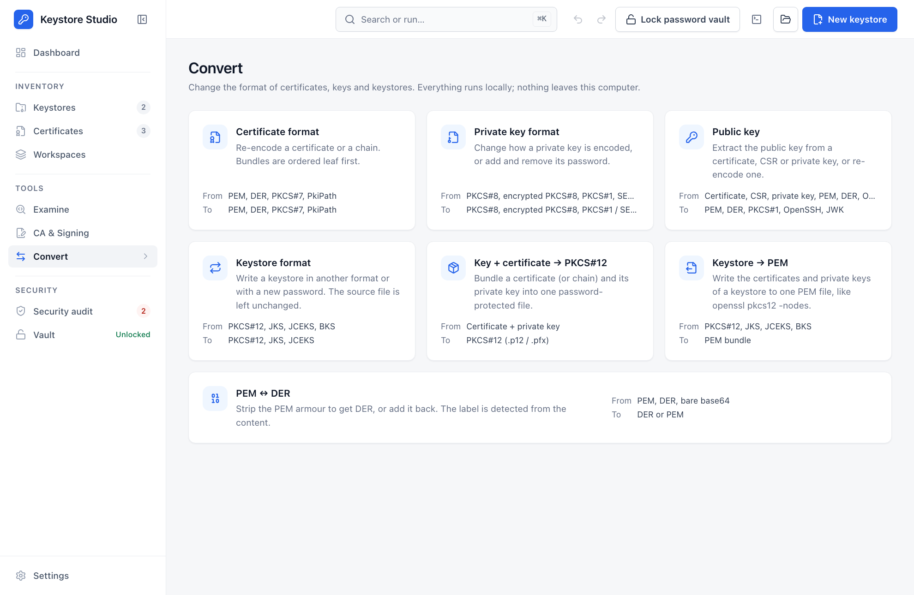
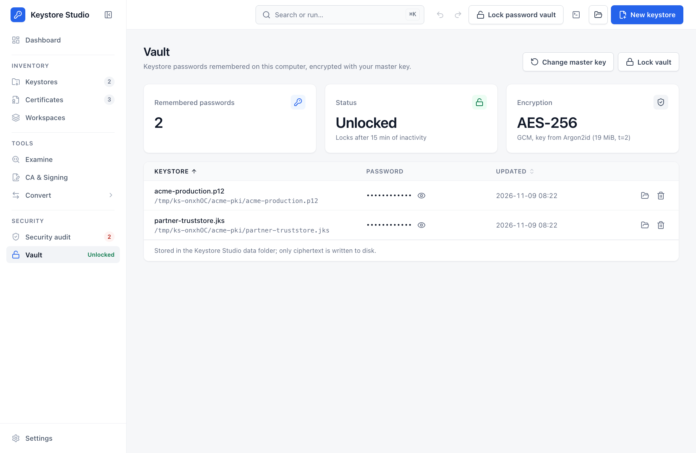
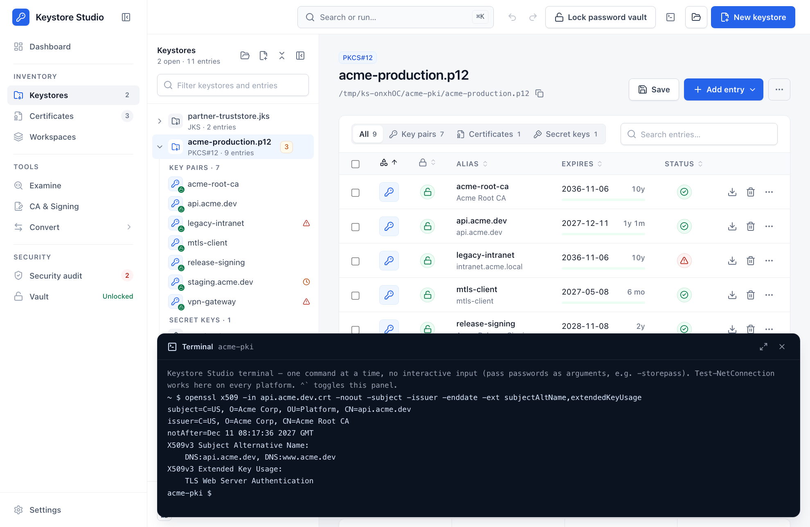
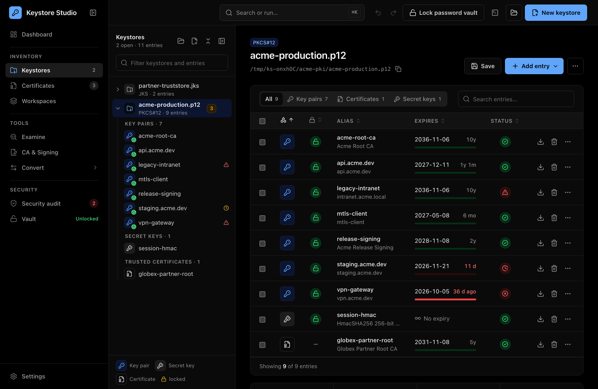
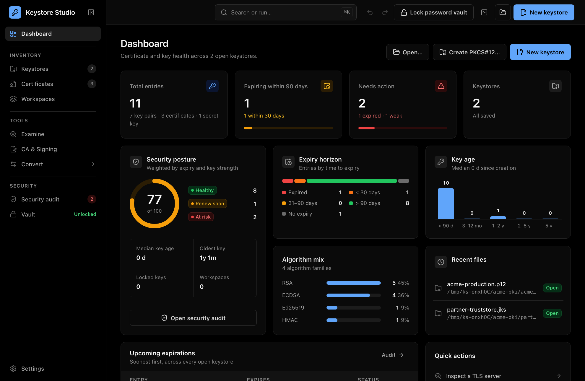

<div align="center">


# Keystore Studio

**A native desktop workbench for Java keystores, PKCS#12 files and X.509 certificates.**

Open, edit and convert keystores, issue and inspect certificates, sign CSRs, CRLs, CMS, JARs and
JWTs, audit key health and inspect live TLS servers, all in one app. Built with Rust, Tauri v2
and React. Every cryptographic operation runs locally in the bundled Rust engine.

Windows · macOS · Linux &nbsp;|&nbsp; MIT licensed

</div>



---

## Contents

- [Why Keystore Studio](#why-keystore-studio)
- [A tour of the app](#a-tour-of-the-app)
- [Feature reference](#feature-reference)
- [Supported platforms](#supported-platforms)
- [Installing](#installing)
- [Data, privacy and security](#data-privacy-and-security)
- [Development](#development)
- [Testing](#testing)
- [Architecture](#architecture)
- [Limitations](#limitations)
- [License](#license)

## Why Keystore Studio

`keytool` and `openssl` are powerful, but day-to-day certificate work means juggling flags,
formats and passwords across both. Keystore Studio puts that work in one window:

- **One place for every format.** PKCS#12, JKS, JCEKS and Bouncy Castle BKS, UBER and BCFKS
  keystores; PEM/DER certificates, chains, PKCS#7 bundles, PkiPath and Netscape sequences;
  PKCS#8/PKCS#1/SEC1/DSA, OpenSSH and JWK keys; SSH2 public keys; CSRs, CRLs and JWTs.
- **Interoperable by design.** Everything it writes is read back by `keytool`, `jarsigner` and
  `openssl` in the test suite, and each conversion shows you the equivalent command line.
- **Local only.** No accounts, no telemetry. The only network traffic is the TLS handshakes,
  connection tests and timestamp requests you start yourself.
- **Safe with your files.** Saves are atomic and read back before they replace the original, edits
  can be undone, and unsaved changes are guarded on close.

## A tour of the app

The screenshots below show the real app (production UI and Rust engine) with demo keystores
made by `keytool` and `openssl`. [Regenerate them](#regenerating-the-screenshots) after UI changes.

### Keystores

Open any number of keystores side by side. The navigator groups each keystore's entries by type
(key pairs, secret keys and trusted certificates). The entry table shows expiry and health at a
glance, and warning badges flag expired, expiring and weak entries.


Select an entry to inspect it: subject and issuer, validity, key and signature algorithms, the full
chain, every extension, and the public and private key. The same panel exports the entry, creates a
CSR, installs a CA reply, renames it or adds labels.


### Certificates

Certificate files opened on their own (PEM, DER, chains, PKCS#7 bundles) get their own page, with
one row per certificate. You can filter CAs and end-entity certificates, add them to a keystore or
workspace, and export them in any format.



### Examine

Inspect a live TLS server: protocol, cipher suite, ALPN, handshake time, the full chain, and a trust
and hostname verdict against your operating system's trust store. The same page tests whether a
port is reachable, decodes anything you paste, and compares two certificates.


### CA & Signing

Use any CA key pair in an open keystore as a certificate authority. Sign CSRs (the request is
verified and its SANs and usages shown first), issue CRLs, create and verify CMS/PKCS#7 signatures,
sign and verify JWTs, sign JARs that `jarsigner` accepts, add RFC 3161 timestamps, and generate DH
parameters.



### Convert

Every format conversion in one place. Each converter shows the equivalent `openssl` or `keytool`
command, so you can script what you just did.



### Security audit

A health score across every open keystore, with findings for expired and expiring certificates,
short keys, SHA-1 signatures, legacy keystore formats and incomplete chains. Remediation is one
click away: **Rotate key** replaces the key and keeps the subject, SANs and usages, and **Renew**
re-issues the certificate with the same key from the open issuing CA. The report exports to CSV.


### Vault

Remember keystore passwords under a single master key. Keys are derived with Argon2id and each
secret is sealed with AES-256-GCM. The vault auto-locks after inactivity, and keystores from your
last session reopen once it is unlocked.



### Terminal and command palette

A built-in terminal (`` Ctrl+` ``) runs `keytool`, `openssl` and friends without leaving the app,
with ready-made commands for the open keystores. `Test-NetConnection` works on every platform.
The command palette (`Ctrl+K`) reaches every page, action, keystore and entry.




### Dark theme

Light, dark (true black) or follow the system, under Settings → General → Appearance.

| Keystores | Dashboard |
| --- | --- |
|  |  |

## Feature reference

| Area | What you can do |
| --- | --- |
| **Keystores** | Open, create, edit and save **PKCS#12**, **JKS**, **JCEKS** and Bouncy Castle **BKS** (versions 1 and 2 read, 2 written), **UBER** and **BCFKS** files (keytool/OpenSSL compatible; the Bouncy Castle writers reproduce Bouncy Castle's own files byte for byte). Convert between all six and change passwords with *Save as…*. PKCS#12 can be written in a compatibility profile (3DES, SHA-1 MAC) for Java 8 and Windows 7. Stores without a password open too. Key pairs, trusted certificates and secret keys, each with its own icon. Open keystores are listed in a navigator beside the entry table, each with its entries grouped by type, so a session with many keystores stays manageable. Key pairs open locked and need their key password before they can be inspected, exported, copied or used for signing (Settings can turn this off). Per-key passwords (JKS/JCEKS) are preserved. Undo/redo, cut/copy/paste between keystores, rename, labels, CSV inventory export. Unsaved-changes tracking with a guard on close/quit. |
| **Certificates** | Certificate files opened on their own (PEM, DER, chains, PKCS#7 bundles) are listed under Keystores, one row per certificate with its type, algorithm, expiry and health. Inspect, export (PEM, DER, PKCS#7, public key, JWK), copy, add to any open keystore or to a workspace; paste PEM, or keep certificates found in Examine. The list survives restarts; removing a certificate never changes its file. |
| **Entries** | Generate RSA (2048–4096), ECDSA (P-256/384/521) and Ed25519 key pairs with certificates that are self-signed or issued by any open CA; generate AES/HMAC/3DES secret keys; import trusted certificates (PEM/DER/PKCS#7, bundles), key pairs from PEM/DER (PKCS#8 incl. scrypt and PBES1, PKCS#1, SEC1, DSA, OpenSSL `Proc-Type` encrypted PEM), OpenSSH, JWK or another keystore. Generate CSRs, install CA replies. |
| **Export** | Certificate (PEM/DER), full chain, PKCS#7 (PEM/DER), PkiPath, public key (PEM, OpenSSH, SSH2/RFC 4716, JWK), private key (encrypted or plain PKCS#8, PKCS#1/SEC1, OpenSSH, JWK), single-entry PKCS#12, secret key (hex, JWK). |
| **Build a PKCS#12** | Bundle an existing certificate (or chain) and its private key into a passphrase-protected **.p12 / .pfx** in one step, without opening a keystore first, from the dashboard or the command palette. The input key may be encrypted (its own password is asked for separately), and it is matched against the certificate before anything is written. Readable by OpenSSL and `keytool`. |
| **Convert** | One place for format conversions, each listed under Convert in the sidebar: certificates (PEM, DER, PKCS#7, PkiPath, Netscape sequence), certificates → truststore in any keystore format, private keys (PKCS#8, encrypted PKCS#8 with AES or legacy 3DES, PKCS#1/SEC1, OpenSSH, JWK), public keys from a certificate, CSR or key (PEM, DER, PKCS#1, OpenSSH, SSH2, JWK), keystores between all six formats, key + certificate → PKCS#12, keystore → PEM bundle, and PEM ↔ DER for any object. Each shows the equivalent OpenSSL, ssh-keygen or keytool command (with the Bouncy Castle provider flags where keytool needs them). |
| **CA & Signing** | Sign CSRs (with CSR inspection and one-click installation into the matching key pair), issue v2 CRLs, CMS/PKCS#7 sign & verify (attached/detached), JWT sign & verify (RS/ES/EdDSA/HS), JAR signing (jarsigner-verifiable), **RFC 3161 trusted timestamps** on CMS and JAR signatures, DH parameters (RFC 7919 groups or freshly generated safe primes). |
| **Examine** | Live TLS inspection (protocol, cipher, ALPN, chain, trust and hostname verdict against the OS trust store), a connection test that says whether a server port can be reached from this machine (every resolved address, source address and interface, connect time, and why it failed: refused, timed out, unreachable or not resolved), decode anything you paste or pick there (certificates, chains, CSRs, CRLs, keys, PKCS#7, JWTs, OpenSSH keys, keystores), compare two certificates. Opened key, CSR, CRL and signature files land here; certificate files go to Certificates. |
| **Security audit** | Health score and findings (expired/expiring, weak keys and digests, deprecated ciphers, incomplete chains, self-signed servers), key rotation that keeps subject/SANs/usages and is re-issued by the original CA when it is open, same-key renewal, CSV report. |
| **Workspaces** | Group keystore entries and certificates from the Certificates page by project or audit scope; persisted across sessions. |
| **Vault** | Remember keystore passwords under one master key (Argon2id → AES-256-GCM), auto-lock after inactivity, change master key (re-encrypts every secret), reset if forgotten. Keystores from the last session reopen automatically once the vault is unlocked. |
| **Tools** | Settings → Tools lists the command-line tools the app refers to (java, keytool, jarsigner, the Bouncy Castle provider jar, OpenSSL, ssh-keygen, PuTTYgen) in one grouped table: found or not, version, path, what uses each, and the install command for the ones that are missing. None of them is needed by the engine. |
| **Productivity** | Window-wide drag and drop, command palette (`Ctrl+K`), keyboard shortcuts, built-in terminal (`` Ctrl+` ``) with ready-made keytool/openssl commands and `Test-NetConnection` built in on every platform (`-ComputerName`, `-Port`, `-CommonTCPPort`, `-InformationLevel Detailed\|Quiet`), recent files, session restore. |

### Keyboard shortcuts

Shortcuts use `Ctrl` on Windows and Linux and `⌘` on macOS (`Ctrl` works there too).

| Action | Shortcut | Action | Shortcut |
| --- | --- | --- | --- |
| Open | `Ctrl+O` | Command palette | `Ctrl+K` |
| New keystore | `Ctrl+N` | Terminal | `` Ctrl+` `` |
| Save | `Ctrl+S` | Switch page | `Ctrl+1` … `Ctrl+8` |
| Save as | `Ctrl+Shift+S` | Convert | `Ctrl+9` |
| Undo / redo | `Ctrl+Z` / `Ctrl+Shift+Z` | Certificates | `Ctrl+0` |

## Supported platforms

| OS | Versions | Installer | Webview |
| --- | --- | --- | --- |
| Windows | 10 and 11 (x64) | `-setup.exe` or `.msi` | WebView2, installed by the setup if missing |
| macOS | 11 Big Sur or later, with Safari 16.4 or later | `.dmg` | WKWebView (system) |
| Linux | Ubuntu 22.04+, Debian 12+, Fedora 38+ or similar | `.deb`, `.rpm`, `.AppImage` | WebKitGTK 4.1, 2.40 or later |

The UI needs a Safari 16.4-level engine (the stylesheet uses `color-mix()`, `@property` and
cascade layers), which sets the macOS and WebKitGTK minimums. The built-in terminal runs commands
with `cmd.exe` on Windows and `/bin/sh` elsewhere, and the suggested commands are quoted for that
shell.

## Installing

Pre-built installers are not published yet. CI builds them on every platform, and you can build
your own:

```bash
git clone https://github.com/framedparadox/keystore-studio.git
cd keystore-studio
pnpm install
pnpm tauri build        # writes installers to src-tauri/target/release/bundle/
```

You need Node 22, pnpm 10, stable Rust (edition 2024) and the
[Tauri system dependencies](https://v2.tauri.app/start/prerequisites/) for your OS.

## Data, privacy and security

- **Keystore contents and passwords are held in memory only.** They reach disk solely in the
  keystore files you save. Saves are written atomically, then read back to verify them before
  they replace the original.
- **Session state** (paths of open keystores, workspaces, labels, recent files, settings) is
  stored in the app data folder. No key material is stored there.

  | OS | Data folder |
  | --- | --- |
  | Linux | `~/.local/share/keystore-studio` |
  | macOS | `~/Library/Application Support/keystore-studio` |
  | Windows | `%APPDATA%\keystore-studio` |

  Set `KEYSTORE_STUDIO_DATA_DIR` to use another folder. A data folder left by the app under its
  former name, `xkeystore`, is moved to the new location on first start, so your vault, session
  and settings carry over.
- **Remembered passwords** are sealed individually with AES-256-GCM under the vault key (bound
  to their ID as associated data). The master key itself is never stored.
- **No telemetry.** Network requests happen only when you inspect a TLS server, test a connection,
  or request a timestamp from a TSA. Settings → Privacy policy has the details.
- **Hardening.** The webview runs under a strict Content Security Policy, the parsers are fuzzed,
  and `cargo deny` checks dependencies for advisories and licences in CI.

## Development

```bash
pnpm install
pnpm tauri dev          # desktop app with hot reload
pnpm tauri build        # release bundles (.deb/.AppImage, .dmg, .msi …)
```

`pnpm dev` serves the UI in a browser for layout work only; the native engine is unavailable there.
UI conventions (tokens, components, layout, contrast) are documented in [DESIGN.md](DESIGN.md).

### Signed Windows installer

```powershell
az login
pnpm build:windows:signed                       # setup .exe in src-tauri/target/release/bundle/nsis/
pnpm build:windows:signed -Bundles "nsis,msi"   # setup .exe and .msi
pnpm build:windows:signed -Store                # offline installer for the Microsoft Store
```

This signs with [Azure Artifact Signing](https://learn.microsoft.com/azure/artifact-signing/). It
needs the Windows SDK signing tools, the .NET 8 runtime, the Azure CLI and the signing client tools
(`winget install -e --id Microsoft.Azure.ArtifactSigningClientTools`). Your account needs the
**Artifact Signing Certificate Profile Signer** role. The account and certificate profile are set in
[scripts/artifact-signing.json](scripts/artifact-signing.json). Ordinary `pnpm tauri build` runs
stay unsigned.

#### Microsoft Store

`-Store` embeds the WebView2 offline installer, because the Store rejects installers that download
anything. It writes to the same file name as an ordinary build, so copy the one you want to keep.

1. Upload the setup `.exe` to a direct HTTPS link that includes the version. Never replace the file
   behind a submitted link; each release needs a new one.
2. In Partner Center, create an **EXE or MSI app** and reserve its name.
3. Add the package link, architecture `x64` and the silent install parameter `/S`.

The publisher name in [src-tauri/tauri.conf.json](src-tauri/tauri.conf.json) (`bundle.publisher`)
should match the one on your Partner Center account. See Microsoft's
[package requirements](https://learn.microsoft.com/windows/apps/publish/publish-your-app/msi/app-package-requirements).

### Regenerating the screenshots

```bash
pnpm screenshots        # pnpm build && node e2e/readme-screenshots.mjs
```

This creates demo keystores and certificates with `keytool` and `openssl`, then drives the real UI
in headless Chrome against the real engine (the same set-up as the headless UI tests, below). It
writes the PNGs to `docs/screenshots/`. The Examine screenshot inspects `github.com:443`, so it needs
network access. `XKS_SCREENSHOTS=<dir>` writes them somewhere else.

## Testing

```bash
pnpm typecheck          # TypeScript
pnpm test               # frontend unit tests (Vitest)
pnpm test:rust          # Rust unit tests + interop tests against keytool, jarsigner and openssl
pnpm test:e2e           # builds the app and drives a full user journey via tauri-driver
pnpm test:e2e:headless  # drives the real UI in headless Chrome against the real engine
pnpm test:all           # typecheck, unit tests, clippy and Rust tests in one go

# What the CI lint job runs:
cargo clippy --manifest-path src-tauri/Cargo.toml --all-targets -- -D warnings
cargo deny --manifest-path src-tauri/Cargo.toml check    # advisories, licences, sources, bans
```

- **Interop tests** (`src-tauri/tests/interop.rs`) round-trip keystores, CSRs, CRLs, CMS, JARs, DH
  parameters and exports through the real `keytool`, `jarsigner`, `openssl` and `ssh-keygen`, and
  run a TLS handshake against `openssl s_server`. Each test is skipped if its tool is missing.
- **Robustness tests** (`src-tauri/tests/robustness.rs`) feed every parser malformed input
  (truncations, bit flips, forged length headers of real keystores, and a deep-nesting case) and
  assert that each returns an error rather than panicking. `XKS_MUTATION_POINTS=2000` runs a
  deeper sweep. For coverage-guided fuzzing see [src-tauri/fuzz/README.md](src-tauri/fuzz/README.md).
- **End-to-end** (`e2e/app.e2e.mjs`) needs `tauri-driver` (`cargo install tauri-driver --locked`)
  and WebKitWebDriver (`webkit2gtk-driver` on Debian/Ubuntu); on a headless machine run it with
  `xvfb-run -a`. It creates, saves, edits, signs, audits, restarts and restores a session, and
  verifies the written files with keytool/openssl. Native file dialogs are scripted only when the
  app is started with `KEYSTORE_STUDIO_E2E=1`.
- **End-to-end on macOS** (`e2e/eval-drive.mjs`, `pnpm test:e2e:mac`) replaces the above, where
  `tauri-driver` has no WKWebView backend. It drives the real window over a local bridge and needs
  no display permissions. The binary **must** be built with the `custom-protocol` feature
  (`pnpm tauri build --debug --no-bundle`, or `cargo build --features custom-protocol`); without
  it the webview is pointed at `devUrl` and stays blank unless `pnpm dev` is running, and the
  bridge exits saying so.
- **End-to-end in a browser** (`e2e/headless-ui.mjs`, `pnpm test:e2e:headless`) is a lighter
  alternative that needs no Tauri build at all, which makes it useful for iterating on UI code and
  for CI without a WebKit runtime. It serves the production `dist/` bundle, points
  `window.__TAURI_INTERNALS__` at `src-tauri/examples/ui_bridge.rs` (which calls the same engine
  functions as the Tauri commands), and drives the real React UI in headless Chrome: it builds a
  PKCS#12, unlocks keys, converts certificates, keys and keystores, and verifies what it writes with
  `openssl` and `keytool`. Its "review" steps guard the behaviour fixed in the 2026-11-08 review
  (GAPS.md, Section 8): key unlocking on every path, stacked dialogs and focus, undo across opened
  files, Save As, bulk actions. The webview and the IPC transport are the only things replaced; the
  UI code and the crypto are the real ones. It runs on a pinned Chrome for Testing build that
  Selenium Manager downloads once (an everyday Chrome with an update pending ends headless sessions
  after ~35 s); `XKS_CHROME=system` uses the installed Chrome instead. `XKS_SCREENSHOTS=<dir>` saves
  screenshots.

CI (`.github/workflows/ci.yml`) runs the type check, unit tests, Rust tests with the interop suite,
clippy, rustfmt, cargo-deny, a fuzz smoke run, the Linux WebDriver journey and the headless UI
suite on Ubuntu, and builds the installers on Linux, macOS and Windows.

## Architecture

```
src/                      React UI
  state/store.tsx         app state: open keystores (+ in-memory passwords), undo/redo, workspaces,
                          labels, settings, vault status, open/save/close flows, session persistence
  lib/api.ts              typed wrappers for every Tauri command
  views/                  one file per page; components/ shared UI (see DESIGN.md)
src-tauri/src/            Rust engine (crate keystore_studio_lib)
  keys.rs  x509.rs        keys, signing/verification, certificate/CSR/CRL building and parsing
  pkcs12.rs jks.rs        keystore codecs (javaser.rs: JCEKS sealed secret keys), pbe.rs: PBE schemes
  bks.rs bcfks.rs         Bouncy Castle BKS/UBER and BCFKS; modes.rs: AES-CCM, AES-KWP, RC4
  openssh.rs              OpenSSH private keys and RFC 4716 public keys; tools.rs: external tool detection
  ops.rs entry.rs         entry operations and display models
  cms.rs jwt.rs jar.rs dh.rs tls.rs detect.rs export.rs  netcheck.rs: TCP connection test
  vault.rs                master-key vault; terminal.rs: built-in shell
  commands.rs             Tauri commands (all run off the UI thread), behind the tauri-app feature
src-tauri/examples/
  ui_bridge.rs            HTTP sidecar exposing the engine to the headless UI tests and screenshots
e2e/                      end-to-end suites and the README screenshot script
```

The engine modules depend on no GUI toolkit: building with `--no-default-features` gives the
engine alone, which is how the fuzz targets and the UI bridge link it.

## Limitations

- **Bouncy Castle edge cases.** BCFKS stores protected with HMAC-SHA3-512, or holding PBE-key
  entries, are not fully supported (the first is refused, the second listed as not shown). A
  signature-protected BCFKS store is verified against the certificate inside it, without a trust
  decision, and is saved back with a password MAC. UBER store version 0 is not read.
- **PuTTY `.ppk`** keys are not read; convert them with `puttygen key.ppk -O private-openssh`.
- **PKCS#11 hardware tokens** are not supported. Keys on a token cannot be exported, so signing has
  to happen on the device through a vendor library; that does not fit the "a keystore is a file"
  model the app is built on.
- **Post-quantum keys** (ML-DSA, ML-KEM, SLH-DSA) written by newer JDKs, and DSA, Ed448 and
  RSA-PSS keys, load and save losslessly but cannot be used for signing. DSA and RSA-PSS
  signatures on certificates, CSRs and CRLs are verified.

PKCS#12 files are written with the classic MAC for maximum compatibility; PBMAC1 (RFC 9579) is read
and can be written. Timestamp tokens are bound to the signature they cover, but the timestamp
authority's own certificate chain is not validated in-app; `openssl ts -verify` and
`jarsigner -verify` do that.

[IMPROVEMENT.md](IMPROVEMENT.md) explains why each gap exists and what is planned.
[GAPS.md](GAPS.md) is the developer backlog: defects, missing certificate and keystore operations,
and the todo list for tackling them. [docs/APP_READINESS.md](docs/APP_READINESS.md) is the latest
full-app readiness review (coverage, design, security posture and release blockers).

## License

MIT. See [LICENSE](LICENSE).
